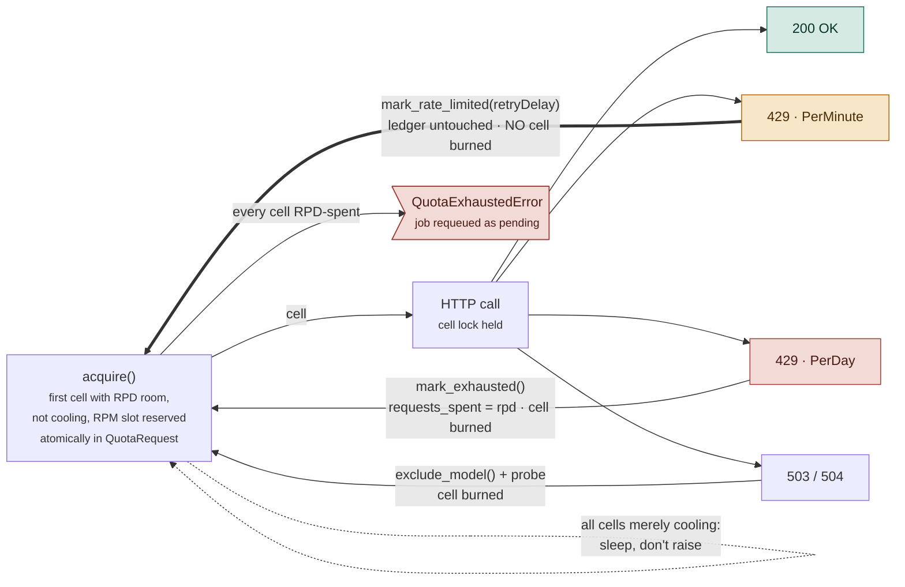

# ADR-0058: A per-minute 429 and a per-day 429 are different facts, read off the payload

- **Status:** Accepted (amends [ADR-0028](0028-key-model-quota-ladder.md))
- **Date:** 2026-08-25
- **Deciders:** Anubhav
- **Amended by:** [ADR-0060](0060-unknown-429-scope-defaults-to-per-minute.md) -- the
  unknown-scope fallback below is **reversed**: an unidentifiable 429 is now treated as
  per-minute, and `RetryInfo` is read as evidence even when a `quotaId` accompanies it. The
  `quotaId` reading, the `mark_rate_limited` path, and "cells burned, not calls made" are
  all unchanged. This is the "Revisit when" condition below firing for real: the fallback
  cost was measured at 65 of 66 cells slammed inside 100 seconds, because the pipeline's
  fan-out makes misclassifications correlated rather than independent.

## Context

A generation run against 17 keys stopped with:

```
QuotaExhaustedError: All 17 key(s) x 2 model(s) exhausted for 2026-08-25
```

Every one of those keys still had nearly its full daily quota. Nothing was exhausted.

The provider's actual 429 envelope says which limit was hit:

```json
{"error": {"code": 429, "status": "RESOURCE_EXHAUSTED", "details": [
  {"@type": ".../QuotaFailure", "violations": [
    {"quotaId": "GenerateRequestsPerMinutePerProjectPerModel-FreeTier"}]},
  {"@type": ".../RetryInfo", "retryDelay": "13s"}]}}
```

`PerMinute` means "come back in 13 seconds." `PerDay` means "this key is done until
midnight." Nothing in the codebase read that field. `_invoke_with_retry` treated every 429
identically and called `mark_exhausted`, which writes `requests_spent = rpd` — so a
thirteen-second throttle was recorded as a day-long exhaustion.

Two earlier fixes treated the symptom without making the distinction:

- **`_FLASH_LITE_MAX_RESETS = 10`** (df8c4e1) — for models with `flash-lite` in the name, a
  429 instead set a 60s cooldown and reset `requests_spent` to **0**, ten times per cell
  before falling through to a real exhaustion. It half-recognised that a 429 can be
  temporary, but guessed at *which* 429s by model name and capped it by strike count.
- **The self-pacing queue** (e6947a6) — `acquire()` now sleeps instead of raising when cells
  are merely cooling. That correctly handles *our own* RPM window filling up, but it never
  sees a 429; by the time the provider rejects a call, `mark_exhausted` has already run.

So the failure mode survived both. `_invoke_with_retry` tries `key_count * len(ladder)` cells
— 34 here — and `mark_exhausted` cools each cell as it goes, so **one** throttled call walked
the entire grid, spending one of every cell's ten reset lives. Ten such calls and the whole
grid was written up to its RPD ceiling with the real quota untouched.

The reset path also destroyed the ledger's meaning. Zeroing `requests_spent` on every 429 left
`quota_ledger` no longer counting the day's real consumption for any flash-lite cell, which
made the 10-strike hatch the *only* route to exhaustion — the genuine 500/day ceiling was
unreachable by counting. It inverted the recovery probe too: ADR-0056's probe calls
`mark_exhausted` precisely to keep a dead model out of rotation for the day, and for a
flash-lite model that call reset its spend instead.

## Decision

**Classify the 429 before reacting to it, from `quotaId` in the provider's own envelope.**

`_classify_rate_limit` (langchain_impl.py — the only module allowed to know the SDK's error
shape) reads `APIError.details` and returns whether the limit is daily, plus any `RetryInfo`
delay. `_invoke_with_retry` then branches:

- **per-day** → `mark_exhausted` as before: ledger written, cell out for the day.
- **per-minute** → `QuotaGovernor.mark_rate_limited`, a new sibling that parks the cell for
  `retryDelay` seconds **and does not touch the ledger at all**. `acquire()`'s existing
  `candidate_wait_times` queue — built by e6947a6 and never fed a provider-supplied delay
  until now — waits it out.



The thick amber edge is the entire change: it is the only path back to `acquire()` that costs
neither a ledger write nor a cell-attempt.

Unknown scope falls back to **daily**, the conservative direction: a per-minute limit misread
as daily costs one cell for a few hours, while a daily exhaustion misread as per-minute would
retry a genuinely dead cell hundreds of times. A lone `RetryInfo` at or under one RPM window
counts as per-minute on its own, since no per-day exhaustion resolves itself inside a minute.

> **Reversed by [ADR-0060](0060-unknown-429-scope-defaults-to-per-minute.md).** "Costs one
> cell for a few hours" assumed misclassifications are independent. They are correlated --
> the pipeline fans out across subtopic-tiers at once, so every in-flight call is throttled
> together and every one is misread together. The measured cost was the whole grid for the
> rest of the day. Unknown scope now falls back to per-minute, and `RetryInfo` is read even
> when a `quotaId` is present.

**`max_attempts` now counts cells burned, not calls made.** A per-minute 429 doesn't use a cell
up, so it no longer consumes the grid's attempt budget. Those retries are bounded by real
quota instead of a cap: every `acquire()` increments a ledger that now only ever counts **up**,
so a cell that keeps throttling still walks toward its own RPD ceiling and drops out on its
own. Once every cell has, `acquire()` raises `QuotaExhaustedError` — a real terminal condition.

**`_FLASH_LITE_MAX_RESETS`, `_flash_lite_reset_counts`, and the model-name sniffing are
deleted.** `mark_exhausted` means one thing again for every model: spent until midnight.

### Two reasons our RPM window disagreed with the provider's in the first place

Classifying 429s correctly makes them cheap. Two separate defects were making them *frequent*,
both of the same kind — our per-minute window was counting something other than what Google
counts.

**The window was anchored to reservation time, not send time.** `acquire()` stamped the window
when it *granted* a cell, but the request fires later: the caller still has to win `cell_lock`,
which queues behind any other call on that cell. Under a parallel fan-out that gap is real
seconds, so we would count a request in the minute it was reserved while Google counted it in
the minute it arrived. Both sides then believe they are under the ceiling and Google is the one
who is right. Note this gap only opens under concurrency — served serially, reserve and send are
the same instant, which is why it never showed up in smaller runs.

The fix is *not* simply moving the stamp to send time: with nothing recorded at grant time,
concurrent callers would all see an empty window and pile onto one cell. So a slot is now
**reserved** by `acquire()` and **confirmed** by `note_request_sent` at the real send, which
updates the reservation's timestamp in place rather than adding a second row — the count is
unchanged, and only the moment it leaves the window moves, always later.

**Probe traffic was invisible to the window.** `record_probe_attempt` spent RPD but never
touched RPM, so a recovery probe ([ADR-0056](0056-generation-call-timeout-and-recovery-probe.md))
could ping a cell and real traffic would immediately be granted that same cell as though nothing
had happened. Probes now reserve a slot like anything else. They still don't *ask* for room —
a probe is deliberate — but everything else now knows one was taken.

`note_request_sent` sits inside `_invoke_with_backoff`'s retry loop, the module's single
outbound send site, so a 503 retried on the same cell is counted as the additional real request
it is. The original reservation only ever covered the first attempt.

### The window moved into the database, for the same reason the ledger already lives there

`_record_rpm`/`_rpm_windows` were originally an in-memory sliding window per `QuotaGovernor`
instance, on the reasoning that a short-lived batch worker doesn't need RPM to survive a
restart, and a DB round-trip per request was too much to pay. That reasoning was never wrong
about restarts — it was wrong about what else calls `acquire()`. `POST /topics` (topic
validation, topic matching) and free-text quiz grading both run in the **API process**, on the
same `thinking` pool the **worker** uses for curriculum and gate passes, at a ceiling as low as
5 RPM. Two processes, each independently permitting the full 5, on a limit of 5.

`QuotaLedger` gained `cooldown_until` (replacing the in-memory `_cooldowns` dict) and a new
table, `QuotaRequest` (`backend`, `sent_at`, `confirmed`), replaced the in-memory window
entirely — one row per request, pruned once it ages out (`prune_request_window`, called
opportunistically from `acquire()`; nothing reads this table for history). Both are keyed on
the same `backend` string the ledger already uses, because they describe the same cell on two
different time horizons.

The check-and-reserve has to be one statement, not two: `_try_reserve_rpm` is
`INSERT ... SELECT ... WHERE (count in window) < rpm`, decided inside the database. A count
followed by a separate insert is exactly the race this exists to close — two processes both
read "4 of 5 used," both insert, and the provider sees 6.

**The round-trip objection turned out to be small in practice.** `acquire()` already does up
to `key_count × len(ladder)` sequential ledger reads in its worst case — one more per-cell
query for RPM doesn't change the shape of that cost, only its size. Cross-process correctness
was worth more than the query saved.

A real bug turned up building this, worth recording because it would have shipped invisibly
otherwise: `_acquire_locked`'s self-pacing sleep loop (e6947a6) held `now` fixed for the
entire call, across every `await asyncio.sleep(...)` retry. Comparing a persisted
`cooldown_until`/RPM window against a `now` that never advances means the wait branch, once
entered, compares the same two timestamps forever — confirmed live, as an actual hang, not a
theoretical one: a test session sat `idle in transaction` holding the row lock from its own
unresolved reservation. Previously this was masked by RPM being real wall-clock
(`time.monotonic()`) internally regardless of the caller's `now`; tying RPM to the caller's
`now` for persistence and testability reintroduced the staleness the monotonic clock had been
hiding. The fix advances `now` by the sleep duration on each iteration (and recomputes `day`
with it, so a wait that crosses midnight uses the right ledger row). This is exactly the kind
of runaway CLAUDE.md's "no unilateral safety caps" guidance argues against inventing a cap
for — the fix is making the loop's own termination condition correct, not bounding its retries.

## Consequences

**Easier.** A rate-limited run now paces itself through the real daily quota instead of
declaring bankruptcy at the first burst. `quota_ledger.requests_spent` is a truthful count of
the day's consumption again, so it can be read directly to answer "how much is actually left."
The recovery probe's `mark_exhausted` does what its name says on every model. And the governor
no longer branches on model names, so a future ladder entry gets correct handling for free.

**Harder.** We now depend on Google populating `quotaId` — an undocumented-stability field. If
they stop, every 429 lands in the unknown-scope fallback and behaviour reverts to today's
(over-eager exhaustion), which is the safe direction but is the bug we just fixed. The
regression signal is `mark_rate_limited` disappearing from the logs while 429s continue.

Per-minute retries now consume real RPD, since `acquire()` increments before the call and a
rejected request may not count against the provider's own daily total. That over-counts in the
safe direction, at the cost of some genuine daily headroom under sustained throttling.

> **Measured, split in two, and half of it fixed by
> [ADR-0061](0061-refund-grants-that-never-became-requests.md).** The drift was ~19% (ledger
> 107 vs the provider's 87). A grant that never became a request at all is now refunded by
> the prune. A *rejected* request stays counted, deliberately: this branch retries without
> burning a cell, so the climbing ledger is the only thing that ends the loop.

The RPM window is now slightly *more* restrictive than before at the same configured ceiling:
slots expire from the send rather than the reservation, and probe and 503-retry traffic that
used to be free now occupies slots. That is the point — it was under-counting real requests —
but throughput at a given `rpm` figure will read a little lower than it did.

A reservation still relies on its caller reaching `note_request_sent`. One abandoned between
`acquire()` and the send holds a slot until it ages out of the window, costing that cell a
little throughput for up to a minute. Bounded and self-healing, so it is not guarded further.

**The window is now shared, not merely aligned.** Moving `QuotaRequest` into the database
closes the cross-process gap directly: the API and the worker draw from the same table, so the
ceiling belongs to the key rather than to whichever process asked. `acquire()` gained one more
query (`_try_reserve_rpm`) and one opportunistic prune per call — real cost, small next to what
was already there, and worth it for a ceiling that means what it says regardless of how many
processes are drawing on it. The provider is still the final authority — no local accounting
can perfectly predict another company's limiter — which is exactly why the per-minute 429 path
has to stay cheap rather than merely rare.

**Committed to.** Any new failure signal on the LLM call boundary gets classified before it's
recorded. This is the same house rule as CLAUDE.md's "a *failed* outcome and a *rejected*
outcome are never the same number", one layer down: two distinct provider conditions must
never collapse into one number.

## Alternatives considered

**Raise `_FLASH_LITE_MAX_RESETS`.** Ten strikes to fifty. Buys time proportional to the number
and delays the same false exhaustion; the count was never the thing that was wrong.

**Lower `max_concurrent_generation_calls` to avoid the burst.** Reduces how often per-minute
429s happen without changing what happens when one does, and pays for it in throughput on
every run — including runs that were never going to be throttled. Treats a correctness bug as
a tuning problem.

**Parse `retryDelay` alone and ignore `quotaId`.** Simpler, and `RetryInfo` is present on the
throttles we captured. But it's an inference where the payload offers a direct statement, and
it fails exactly when it matters most — a per-day 429 that happens to carry a short delay
would be retried all day.

**Treat unknown-scope 429s as per-minute.** Symmetrical, and self-corrects eventually since the
ledger still counts up. But it burns hundreds of real requests against a dead key first. The
asymmetry in the costs is what decides the fallback direction.

> **This alternative was adopted the next day, by [ADR-0060](0060-unknown-429-scope-defaults-to-per-minute.md).**
> The asymmetry was measured rather than assumed, and it runs the other way: the dead-key
> retries are bounded (parked 60s, interleaved across 66 cells, cell retires itself via the
> ledger), while the daily fallback's cost was the entire grid for a day.

## Revisit when

- `mark_rate_limited` stops appearing in logs while 429s keep arriving — the envelope's shape
  has changed and everything is falling through to the daily fallback.
- A paid tier lands. Per-minute limits scale differently there, and the ladder's hand-copied
  RPD/RPM numbers ([ADR-0028](0028-key-model-quota-ladder.md)) would need rechecking anyway.
- Sustained throttling starts eating meaningful daily quota through retried-but-rejected
  requests — that would justify not counting a 429'd acquire against the ledger.
- `acquire()`'s per-cell query count (already up to `key_count × len(ladder)` reads, now with
  one more for RPM) becomes measurably slow against CockroachDB Basic's per-statement latency
  (ADR-0048) at a larger key pool — that's the point to batch-load candidate cells in one
  query instead of looping one `SELECT` per cell, deferred out of this ADR's scope.
