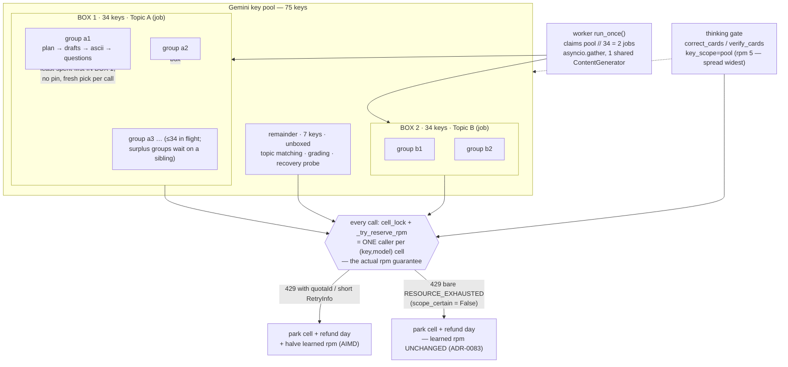

# The rate-limit debugging arc: Run 8 → key boxes → the load balancer

> **Span:** 2026-08-30 → 2026-09-03. **Outcome:** ADR-0082 (fixed key boxes) →
> ADR-0083 (least-spent-first inside a box) → **ADR-0084 (a per-box in-memory
> `LoadBalancer` replaces the DB-backed `QuotaGovernor` wholesale)**.
> **Live DB:** `spoin_db_2`, 75-key pool, box 34, 2 topics concurrent.
>
> This is the "why", so the next session does not re-run the dead ends. The
> decisions are in the ADRs; this is the path between them.
>
> **ADR-0084 note (2026-09-03, unbenchmarked):** the owner called for a
> from-scratch replacement of the quota governor — "it was all AI slop", grown by
> accretion across ten ADRs against a multi-process assumption that no longer
> holds. `quota.py` shrank ~1660 → ~150 lines; `quota_request` + `model_unavailable`
> tables dropped, `quota_ledger` trimmed to `requests_spent`. `make check` green
> (495 tests). **The migration `c4d5e6f708a9` is written but NOT applied** — needs
> the owner's `alembic upgrade head` (the new code runs fine against the
> un-migrated schema; the migration is cleanup). No benchmark run yet: the
> queued topics (Air Pistol, Generative AI, …) are the first real exercise.
> Watch the 429 rate against Run 8's; if it's materially higher the box should
> *grow* (ADR-0082/0084 revisit).

---

## How it works now (2026-09-03)



**Read it as three independent layers:**

| Layer | Unit | Rule | Enforced by |
|---|---|---|---|
| Across jobs | a topic / job | `pool // box_size` run at once (2) | `run_once()` claims exactly that many |
| Within a job | a box of 34 keys | a topic only ever touches its 34; closed, no borrowing | `claimable_keys()` narrows every scan |
| Within a box | one LLM call | least-spent key picked fresh per call (`key_scope="box"`); gate goes pool-wide (`"pool"`) | `_claim_for_scope` + `sticky=False` |
| Every call | one `(key, model)` cell | exactly one caller at a time | `cell_lock` + `_try_reserve_rpm` |

The bottom layer is the only thing that *makes an rpm violation impossible*. The
three above it are load *distribution* — they decide which cell each call lands
on so the bottom layer rarely has to make anyone wait.

```
                         one worker pass
                               │
              claims  pool // 34 = 2  jobs, gather()
                     ┌─────────┴─────────┐
                 Topic A               Topic B
             lease_key_box(34)     lease_key_box(34)      coldest-first,
             ┌──────────────┐      ┌──────────────┐       from ONE shared
             │ box keys     │      │ box keys     │       KeyClaimRegistry
             │  3,7,12,…    │      │  1,4,9,…     │       → disjoint
             └──────┬───────┘      └──────┬───────┘
      subtopic groups fan out       (same, in box 2)
             │  each call:
             │    key_scope="box"  → least-spent key IN {3,7,12,…}, fresh each call
             │    key_scope="pool" → least-spent key in all 75  (thinking gate only)
             ▼
     acquire(key,model)  ── cell_lock ──►  send
             │
        429? ─┬─ has quotaId / short RetryInfo → park + refund + halve rpm
              └─ bare RESOURCE_EXHAUSTED       → park + refund  (rpm left alone)
```

## The problem, stated once

The generation pipeline fans out per subtopic group. Each group's card run is a
*burst* of ~10 structured LLM calls in a few seconds (plan, per-type drafts,
ASCII fetch/redraw), and the gate adds thinking-model calls on rungs as tight as
**rpm 5 / rpd 20**. The Gemini free tier meters *requests per minute per project
per model*, not tokens. So the whole game is: keep many keys busy at a low
per-key rate, and never let one key take a whole burst.

Every regime below is a different answer to "how many callers hit the pool at
once, and which key does each one use". Two failure directions:

- **Too sequential** → most of a big pool sits idle, a queue of topics takes N×
  longer than it needs to.
- **Too parallel / badly scheduled** → per-minute ceilings burst, cells 429,
  the learned-rpm machinery walks healthy cells to the floor, runs stop early
  reading as "quota exhausted" when the day's budget was barely touched.

## The timeline

### Run 8 — the proven baseline (ADR-0073 + ADR-0074, 2026-08-30)

One topic at a time (`ADR-0073`); inside it, one key per subtopic group over the
**whole pool**, own-key-first ladder (`ADR-0074`). Generated **4,139 cards
unattended** — walk-away-safe, the bar every later regime is measured against.
Its limit: a single topic only keeps as many keys busy as it has subtopic groups
in flight, so a 100+ key pool mostly idles and a six-topic queue takes six times
too long.

### ADR-0078 + ADR-0081 — parallel leases, reverted same day (2026-09-01)

Many topics at once, each leasing `N` keys where `N` was its widest difficulty
tier, plus a **shared reserve** any spent group could borrow from. ADR-0081 made
the tier widths real by minting the curriculum in a pre-admission phase.

Reverted within the day (`424142e`). Two specific defects, not just "too many
topics":

1. **`N` was data-derived.** A curriculum with a wide tier admitted itself a big
   lease. Nobody could state before a run how many callers would be on the pool.
2. **The reserve was shared.** A spent group reached *outside* its lease for a
   reserve key another topic was about to be handed. Concurrent-caller count
   became a function of how spent the *other* topics were.

Result: the packer admitted a dozen-plus topics, 40+ subtopic branches ran at
once, the thinking rungs went into sustained 429 storms and per-day exhaustion.

### The 33-key experiment + key→project audit (2026-09-01)

Hypothesis: the 119-key pool was not 119 independent projects — keys sharing a
GCP project share one per-project-per-model quota, so extra same-project keys add
*contention, not capacity*.

- A behavioural probe (`scratchpad/key_cluster_probe.py`, not committed) fired
  25 concurrent calls at each key and watched when it first 429'd. Free-tier
  flash-lite per-project ceiling ≈ **16 req/min**. Phase-A `n_ok` histogram was
  cleanly bimodal — `{16: ~36, ~0: ~45}`, nothing between.
- **5 keys dead** (HTTP 401, service account deleted) — removed.
- **45 keys** were per-day-exhausted on *both* generator models after only ~400
  cards — impossible for 45 independent projects; consistent with ~6 real
  projects (keys minted ~10 per project). Staged out, then ~6 representatives
  kept.
- **Pool today: 75 keys.** (`.env` is gitignored; count it there, not from a
  doc — several changed docs briefly said "69", the pre-representatives number.)

Takeaway: separate keys stop the per-*day* death spiral (2 pins at start vs
~100). They do **not** stop the per-*minute* burst. That still needed a
scheduling fix.

### ADR-0082 — fixed key boxes (2026-09-02)

The owner's ask was the middle: keep a topic's internals exactly as Run 8 proved
them, run a few topics side by side.

**A topic gets a BOX** — `settings.topic_key_box_size` keys (34), for its whole
run, and that box *is* its entire pool. Inside: ADR-0074, unchanged. Outside:
nothing — no shared reserve, no borrowing. `max_concurrent_topics =
pool // box_size` (2 at 75/34), derived, never a second knob. The 7-key
remainder serves the claim-less path (topic matching, grading, the recovery
probe), which stops it competing with generation.

The property ADR-0078 lost and this restores: **total in-flight work is a
constant** — `max_concurrent_topics × box_size` keys, one caller each —
regardless of what is in the queue. Stateable before a run, benchmarkable once.

### ADR-0083 — the load balancer (2026-09-03)

Benchmarking ADR-0082 against the live pool showed boxes alone did not fix
per-minute pressure. Two things left:

**1. The per-group key PIN was scheduling the load into a corner.** ADR-0074
binds a group to the first key it grants, then returns that key for the group's
whole burst. ~10 calls in a few seconds onto one key trips its 15-rpm cell while
33 box keys sit cold. The pin was never what made rpm violations impossible —
`cell_lock` + `_try_reserve_rpm` do that, per cell. The pin was a heuristic on
top, and it was the wrong heuristic.

Fix: `key_scope` — `"sticky"` / `"box"` / `"pool"` — resolved in
`_claim_for_scope` against the contextvar claim. Card writing, planning, ASCII,
questions, repair run `"box"`: box-scoped, **no pin**, least-spent key picked
fresh each call. The gate (`correct_cards` / `verify_cards`) runs `"pool"`: its
rpm-5 rungs must spread widest. `KeyClaim.sticky=False` is what turns the pin
off. This is the **pre-ADR-0074 least-spent-first behaviour**, scoped by the
box.

**2. Halving learned rpm on a scopeless 429 walked healthy cells to the floor.**
Since ~late August, Google returns bare `RESOURCE_EXHAUSTED` with no `quotaId`
and no `RetryInfo` on essentially every 429. ADR-0060 treats that as per-minute
(park + refund) — correct, and unchanged. But ADR-0065's AIMD *also halved* the
cell's learned rpm on every per-minute 429, so on the now-common scopeless path a
cell got ratcheted 15 → 7 → 3 → 1 over a run and never climbed back. Pool
throughput sagged the longer a run went.

Fix: `_RateLimit.scope_certain` (False on a pure guess) → `shrink_rpm` into
`mark_rate_limited` → `_shrink_effective_rpm` fires **only on an identified
per-minute 429**. A guessed one still parks the cell and refunds the day; it no
longer ratchets the ceiling on no evidence.

**Also this session:** `gemini-3.8-flash` prepended to the thinking ladder as the
strongest rung (owner request, live-verified 200). And a **redraft brake**
(`_LATER_PASS_MIN_ROUND_PROGRESS`, nodes.py): a resume/backfill pass hands a
subtopic tier off after 5 consecutive redraft rounds that each close <10% of
their remaining gap — a near-complete tier chasing its last card or two is a
pin-one-key thinking-ladder burst for no real gain; the next backfill pass
resumes it. ASCII prompts also gained a strict "box integrity" rule (treat
fetched art as rigid; captions only at top/bottom/right) — a caption-placement
quality fix, judged not to warrant a `CARD_PROMPT_VERSION` bump since it does not
change the content distribution.

## Dead ends — do not re-run these

- **Width-derived lease sizes** (ADR-0078's `N`). Better utilisation, but the
  concurrent-caller count stops being stateable. Rejected on the owner's call in
  ADR-0082; a topic-count cap in front of it is the only version worth
  reconsidering, and only if boxes routinely sit idle.
- **A shared reserve / lending idle box keys out.** A lend is a borrow seen from
  the other side — it reintroduces exactly the cross-topic coupling ADR-0078 died
  of. ADR-0082 is committed to the box being closed.
- **Treating a scopeless 429 as a per-day exhaustion** (pre-ADR-0060). Stopped
  whole runs early with the day's budget intact. ADR-0060's call stands; only
  the rpm ratchet on the guess was wrong.
- **Tuning the AIMD additive-increase to recover faster** instead of gating the
  decrease. Still pays the decay every time on the common path.
- **Re-seeding / wiping to get a "clean" test DB.** `spoin_db_2` is production
  and has been destroyed 4× (last 2026-09-01, silently). Migration / portability
  / engine experiments are remote-only; `make test` on `spoin_db_test` is the
  safe path. See CLAUDE.md.

## Where the knobs are

| Knob | File | Meaning |
|---|---|---|
| `topic_key_box_size` (34) | `core/config.py` | keys per topic; the *only* dial. Up → fewer, faster topics. Down → more, slower. |
| `max_concurrent_topics` | `core/config.py` (derived) | `pool // box_size`. Never configured. |
| `key_scope` per call | `generation/langchain_impl.py` | `"box"` for generation, `"pool"` for the gate, `"sticky"` for claim-less callers. |
| `scope_certain` / `shrink_rpm` | `langchain_impl.py` / `quota.py` | AIMD rpm shrink fires only on an identified per-minute 429. |
| `_LATER_PASS_MIN_ROUND_PROGRESS` (0.10) | `pipeline/nodes.py` | resume-pass redraft brake. |
| thinking ladder | `core/config.py` / `docker-compose.yml` | `gemini-3.8-flash` … `gemini-3-flash-preview`. |

## Revisit signals (from the ADRs, collected)

- Boxed benchmark 429 rate **above** Run 8's → per-minute pressure binds
  regardless of scheduling; add the global in-flight rpm semaphore (ADR-0082 §
  Alternatives, ADR-0083 § Revisit).
- 429 rate **unchanged** vs Run 8 → headroom exists; shrink the box toward 3–4
  concurrent topics.
- Topics finishing with most of their box idle → fixed size costs more than it
  buys; width-derived + topic-count-cap gets another look.
- Groups routinely waiting on a box key → boxes too small for real curricula;
  raise `topic_key_box_size`.
- Google returns scoped 429s again → `scope_certain` goes True on that path by
  construction; confirm learned rpm actually adapts again.
- Worker becomes a persistent loop → "keep the pool full" replaces "fit this
  pass"; boxes taken/returned continuously.
