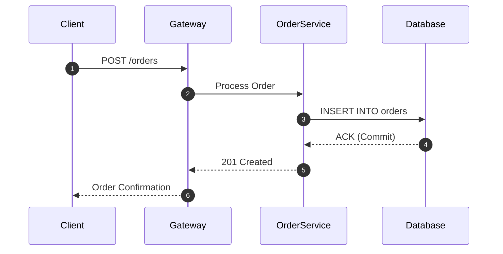

## The Four Archetype Tags and Collapsed Preview Badging

Card content is not uniform; different technical concepts demand different structural representations. ADR-0017 established **archetypes** as a set of content-shape tags attached to a card:
- `code`: The card `body` contains one or more syntax-highlighted code blocks (e.g. ```` ```python ````).
- `diagram`: The card `body` contains a structured architectural diagram or sequence flow encoded in Mermaid syntax.
- `comparison`: The card `body` features a structured comparative layout or Markdown table evaluating trade-offs across multiple technologies, algorithms, or approaches.
- `ascii`: The card carries an attached ASCII art scene in `visual_id` and `visual_slots`.
- `[]` (Empty set): The card consists purely of structured technical prose.

The web and mobile clients use these archetype tags to enrich the collapsed card preview in the feed. Rather than displaying a generic text preview for every card, the client adapts:
- A `code` card displays a programming language pill badge (e.g. `TypeScript`, `SQL`, `Rust`) alongside the first line of the snippet.
- A `diagram` card displays an architectural flowchart indicator.
- A `comparison` card renders a comparative badge indicating trade-off analysis.

## Archetypes are Derived Post-Generation, Never Requested

In early system designs, the generator model was prompted to self-report an `archetype` field in its JSON output. This resulted in frequent misclassifications: models tagged pure prose cards as `diagram` because they described a mental model, or tagged cards as `code` because they mentioned a function name inline.

ADR-0017 eliminated self-reporting. **`archetype` is derived locally and deterministically post-generation**:
- After the generator returns the card draft, the local classifier (`content/archetype.py`) inspects the raw `body` Markdown.
- If it detects a triple-backtick code block with a language tag, it appends `code`.
- If it detects a ```mermaid block, it appends `diagram`.
- If it detects a Markdown table structure (`| --- | --- |`), it appends `comparison`.
- If `visual_id` is populated, it appends `ascii`.

Because structural shapes are objectively verifiable from the raw text, delegating classification to deterministic code guarantees 100% accuracy and conserves prompt token budget.

## Diagrams are Mermaid, Rendered Client-Side

Prior to ADR-0067, models attempted to draw flowcharts, state transitions, and sequence diagrams using manual ASCII text art. This resulted in crooked lines, illegible alignment on mobile screens, and truncated node labels.

ADR-0067 established that **all technical diagrams must be written in Mermaid syntax within Markdown code blocks**:


Key rules governing diagrams:
- **Client-Side Rendering:** The backend emits pure Mermaid text. The web and mobile frontends parse the text and render scalable, interactive SVGs styled to match the dark/light theme of the application.
- **Strict Prohibition on ASCII Flowcharts:** Text-only box-and-arrow diagrams (e.g. `[Client] ---> [Server]`) are strictly forbidden inside ASCII art slots. ASCII art is reserved exclusively for pictorial illustrative scenes and gags. Technical architectures, state machines, and sequence workflows must exclusively use Mermaid.
- **Simplicity and Mobile Viewports:** Diagrams must remain readable on narrow mobile screens. Complex diagrams should be decomposed into multiple simple, sequential steps rather than overflowing wide canvas layouts.
